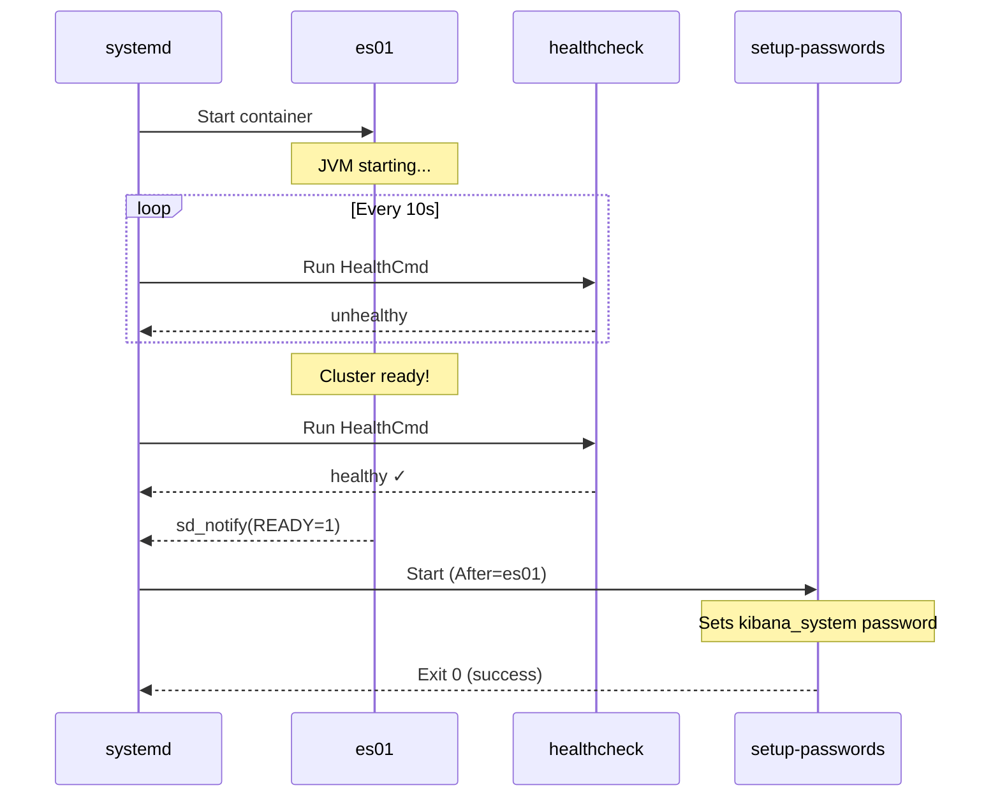

# Elasticsearch Quadlet Migration — Complete Reference

## Files Created

```
elasticsearch/quadlets/
├── elastic.network                    # Bridge network (replaces networks: elastic)
├── elastic-certs.volume               # TLS certificates volume
├── elastic-esdata01.volume            # Elasticsearch data volume
├── elastic-kibanadata.volume          # Kibana data volume
├── elastic.env                        # Shared secrets (passwords)
├── elastic-setup-certs.container      # Oneshot: generates TLS certs & exports fleet certs
├── elastic-es01.container             # Elasticsearch (long-running)
├── elastic-setup-passwords.container  # Oneshot: sets kibana_system password
├── elastic-kibana.container           # Kibana dashboard (long-running)
├── kibana.yml                         # Kibana configuration
├── scripts/
│   ├── setup-certs.sh                 # Cert generation & host export logic
│   ├── setup-passwords.sh             # Password setup logic
│   ├── install_fleet_server           # Fleet server installer helper
│   ├── install_agent                  # Elastic agent installer helper
│   └── elastic_cert_gen               # (Deprecated) Manual cert extraction fallback
└── install.sh                         # Installs Quadlets into /etc/containers/systemd/users/
```

## How the Compose Maps to Quadlets

| Docker Compose | Quadlet | Notes |
|---|---|---|
| `version: "3.8"` | *(not needed)* | Quadlets have no version field |
| `networks: elastic:` | [elastic.network](file:///home/f3gal08/workspace/Home_Server/elasticsearch/quadlets/elastic.network) | `NetworkName=elastic` preserves DNS resolution |
| `volumes: certs:` | [elastic-certs.volume](file:///home/f3gal08/workspace/Home_Server/elasticsearch/quadlets/elastic-certs.volume) | `VolumeName=elastic-certs` |
| `volumes: esdata01:` | [elastic-esdata01.volume](file:///home/f3gal08/workspace/Home_Server/elasticsearch/quadlets/elastic-esdata01.volume) | `VolumeName=elastic-esdata01` |
| `volumes: kibanadata:` | [elastic-kibanadata.volume](file:///home/f3gal08/workspace/Home_Server/elasticsearch/quadlets/elastic-kibanadata.volume) | `VolumeName=elastic-kibanadata` |
| `services: setup:` | [elastic-setup-certs.container](file:///home/f3gal08/workspace/Home_Server/elasticsearch/quadlets/elastic-setup-certs.container) + [elastic-setup-passwords.container](file:///home/f3gal08/workspace/Home_Server/elasticsearch/quadlets/elastic-setup-passwords.container) | **Split into two** (see below) |
| `services: es01:` | [elastic-es01.container](file:///home/f3gal08/workspace/Home_Server/elasticsearch/quadlets/elastic-es01.container) | Uses `Notify=healthy` |
| `services: kibana:` | [elastic-kibana.container](file:///home/f3gal08/workspace/Home_Server/elasticsearch/quadlets/elastic-kibana.container) | Depends on password setup |
| `.env` | [elastic.env](file:///home/f3gal08/workspace/Home_Server/elasticsearch/quadlets/elastic.env) | Only secrets; config is hardcoded in units |
| `depends_on: condition: service_healthy` | `After=` + `Requires=` + `Notify=healthy` | Native systemd dependency ordering |
| `mem_limit:` | `PodmanArgs=--memory 1g` | Podman flag in container quadlet |
| `ulimits: memlock:` | `PodmanArgs=--ulimit memlock=-1:-1` | Podman flag in container quadlet |
| `ports:` | `PublishPort=9200:9200` | Direct mapping |
| `healthcheck:` | `HealthCmd=`, `HealthInterval=`, etc. | Direct mapping |

## The Key Architectural Decision: Splitting `setup`

The original compose `setup` service does everything in one container:


This works in compose because `depends_on: condition: service_healthy` only checks the healthcheck (cert file exists), while the `setup` container keeps running in the background to handle step 5-6.

**Quadlets can't do this** — systemd's `After=` waits for a service to be fully "active", not for an arbitrary health check on a still-running container. If we kept `setup` as one long-running service, we'd have a circular dependency:
- es01 needs setup to finish generating certs → `After=setup`
- setup needs es01 to be running to set the password → circular!

**The fix:** Split into two oneshot services that run at different points in the chain:


## What `Notify=healthy` Does

On [elastic-es01.container](file:///home/f3gal08/workspace/Home_Server/elasticsearch/quadlets/elastic-es01.container#L63-L67):

```ini
Notify=healthy
```

This tells Podman to send systemd's `READY=1` signal **only after the container health check passes** — not when the container process spawns. Without this, systemd would consider es01 "started" immediately, and `elastic-setup-passwords` would try to connect before Elasticsearch is accepting connections.

With `Notify=healthy`, the startup timeline looks like:



## Why Environment Variables Are Hardcoded

In compose, `${CLUSTER_NAME}` gets substituted from `.env` before being passed to the container. Quadlets **can't do runtime variable substitution** — the generator runs at `daemon-reload` time (before any env files are loaded). So values like:

| Compose | Quadlet |
|---|---|
| `cluster.name=${CLUSTER_NAME}` | `Environment=cluster.name=main-cluster` |
| `xpack.license.self_generated.type=${LICENSE}` | `Environment=xpack.license.self_generated.type=basic` |
| `${ES_PORT}:9200` | `PublishPort=9200:9200` |
| `${KIBANA_PORT}:5601` | `PublishPort=5601:5601` |

Passwords (`ELASTIC_PASSWORD`, `KIBANA_PASSWORD`) still come from the env file because those are container-level environment variables read at runtime, not quadlet-level substitutions.

> [!NOTE]
> The Kibana container expects `ELASTICSEARCH_PASSWORD` as its env var name, but your `.env` defines `KIBANA_PASSWORD`. Since Quadlets can't do `ELASTICSEARCH_PASSWORD=${KIBANA_PASSWORD}`, the [elastic.env](file:///home/f3gal08/workspace/Home_Server/elasticsearch/quadlets/elastic.env) file has **both** variables — you must set them to the same value.

## Usage

### Install
```bash
cd elasticsearch/quadlets
./install.sh
```

### Configure passwords
```bash
vim ~/.config/containers/systemd/elastic.env
# Set ELASTIC_PASSWORD, KIBANA_PASSWORD, and ELASTICSEARCH_PASSWORD
```

### Start the stack
```bash
# Starting kibana pulls in the entire dependency chain:
#   setup-certs → es01 → setup-passwords → kibana
systemctl --user start elastic-kibana
```

### Monitor
```bash
# Service status
systemctl --user status elastic-setup-certs
systemctl --user status elastic-es01
systemctl --user status elastic-setup-passwords
systemctl --user status elastic-kibana

# Live logs
journalctl --user -u elastic-es01 -f
journalctl --user -u elastic-kibana -f
```

### Stop
```bash
systemctl --user stop elastic-kibana elastic-es01
```

### Uninstall
```bash
systemctl --user stop elastic-kibana elastic-es01 elastic-setup-passwords elastic-setup-certs
rm ~/.config/containers/systemd/elastic-*.{container,volume,network}
rm ~/.config/containers/systemd/elastic.env
rm -r ~/.config/containers/systemd/elastic-scripts/
systemctl --user daemon-reload
```
