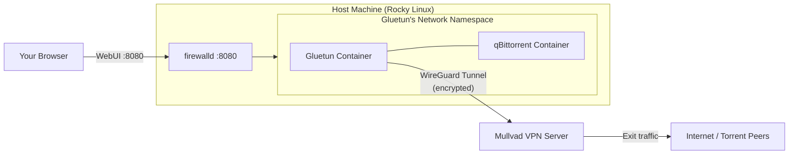
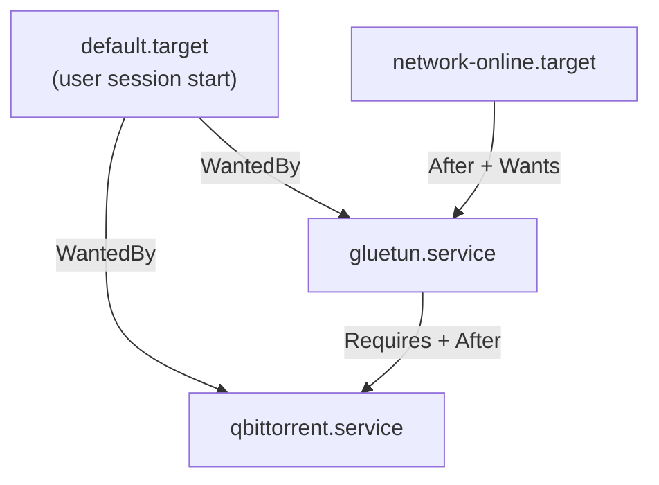

# VPN + qBittorrent Stack: Architecture & Setup Guide

## How It Works



The key concept: **qBittorrent has no network of its own.** It lives entirely inside Gluetun's network namespace via `Network=container:gluetun`. Every single packet — torrent peer connections, DNS lookups, tracker announces, WebUI traffic — enters and exits through Gluetun's WireGuard tunnel.

---

## Files Created

| File | Purpose |
|------|---------|
| [`gluetun.container`](file:///c:/Users/brett/OneDrive/Documents/workspace/Home_Server/vpn-torrent/gluetun.container) | VPN gateway container (Mullvad WireGuard) |
| [`qbittorrent.container`](file:///c:/Users/brett/OneDrive/Documents/workspace/Home_Server/vpn-torrent/qbittorrent.container) | Headless torrent client, routed through Gluetun |
| [`qbt-config.volume`](file:///c:/Users/brett/OneDrive/Documents/workspace/Home_Server/vpn-torrent/qbt-config.volume) | Persistent volume for qBittorrent settings |
| [`scripts/install.sh`](file:///c:/Users/brett/OneDrive/Documents/workspace/Home_Server/vpn-torrent/scripts/install.sh) | Deployment script (root, deploys to `/etc/containers/systemd/users/`) |

---

## The Kill Switch — How It Works

Gluetun's kill switch is **on by default and cannot accidentally be disabled.** Here's what it does:

When Gluetun starts, it configures `iptables` rules inside its network namespace that **only allow traffic through the WireGuard tunnel interface (`wg0`)**. The rules look conceptually like this:

```
ALLOW traffic on wg0 (the VPN tunnel)
ALLOW traffic on lo (localhost, for WebUI access)
DROP everything else
```

If the VPN connection drops:
1. The `wg0` interface goes down
2. The only remaining allowed interface is `lo` (localhost)
3. **All outbound traffic is blocked** — no DNS leaks, no peer connections, nothing
4. Gluetun automatically attempts to reconnect
5. Once reconnected, traffic resumes through the new tunnel

Because qBittorrent shares this same network namespace, it is subject to the exact same iptables rules. It physically **cannot** send traffic outside the tunnel — there is no route, no interface, no way out.

> [!IMPORTANT]
> This is fundamentally different from software-level kill switches in VPN apps (which can fail or be misconfigured). The kill switch here operates at the **kernel firewall level** inside an isolated network namespace. The only way to bypass it would be to break out of the container — which defeats the entire point of containerization.

---

## Why Ports Are Published on Gluetun, Not qBittorrent

This is the most unintuitive part of the setup:

```ini
# In gluetun.container:
PublishPort=8080:8080    # ← qBittorrent's WebUI port, declared HERE

# In qbittorrent.container:
Network=container:gluetun  # ← shares Gluetun's network, NO ports here
```

Because qBittorrent has `Network=container:gluetun`, it doesn't have its own IP address or network interfaces. It's as if qBittorrent is a second process running inside Gluetun. When qBittorrent binds to port `8080`, it's binding to Gluetun's network interface. So the port must be published on Gluetun's container definition.

---

## Mullvad WireGuard Credentials

Before starting, you need two values from Mullvad:

### How to Get Them

1. Log into your [Mullvad account](https://mullvad.net/en/account)
2. Go to **WireGuard configuration** (or directly: https://mullvad.net/en/account/wireguard-config)
3. Generate a key or download a `.conf` file
4. Open the `.conf` file — it looks like:

```ini
[Interface]
PrivateKey = aB1cD2eF3gH4iJ5kL6mN7oP8qR9sT0uV1wX2yZ3a4=    ← WIREGUARD_PRIVATE_KEY
Address = 10.68.123.45/32                                      ← WIREGUARD_ADDRESSES

[Peer]
PublicKey = ...
Endpoint = ...
```

5. Edit [`gluetun.container`](file:///c:/Users/brett/OneDrive/Documents/workspace/Home_Server/vpn-torrent/gluetun.container) and replace the two placeholder values.

> [!CAUTION]
> The `WIREGUARD_PRIVATE_KEY` is a secret. After deploying, the `gluetun.container` file has `chmod 640` (readable only by root and your user). Do not commit this value to a public Git repo. For production, consider using Podman secrets or an environment file with restricted permissions (like your Elasticsearch `elastic.env` pattern).

---

## Dependency Chain



- `gluetun.service` waits for network, then establishes the VPN tunnel
- `qbittorrent.service` has `Requires=gluetun.service` — it **will not start** unless Gluetun is running, and **will stop** if Gluetun stops
- Both start automatically on boot via `WantedBy=default.target` + lingering

---

## Deployment Steps

```bash
# 1. Edit gluetun.container with your Mullvad WireGuard credentials first!

# 2. Run the install script
sudo ./vpn-torrent/scripts/install.sh admin

# 3. Start the stack (Gluetun first, then qBittorrent follows via dependency)
systemctl --user start gluetun.service

# 4. Check Gluetun connected to Mullvad
journalctl --user -u gluetun.service -f
# Look for: "healthy!" or "VPN is up"

# 5. Start qBittorrent
systemctl --user start qbittorrent.service

# 6. Get the initial WebUI password from logs
journalctl --user -u qbittorrent.service | grep -i password

# 7. Open WebUI at http://<server-ip>:8080
#    Paste magnet links directly into the WebUI
```

---

## Verifying the VPN Is Working

From inside the qBittorrent container, check your public IP:

```bash
podman exec qbittorrent curl -s https://am.i.mullvad.net/connected
```

This should return something like:
> `You are connected to Mullvad (server xx-xxx-wg-001). Your IP address is xxx.xxx.xxx.xxx`

If Gluetun is down, this command will **time out** (kill switch working).
